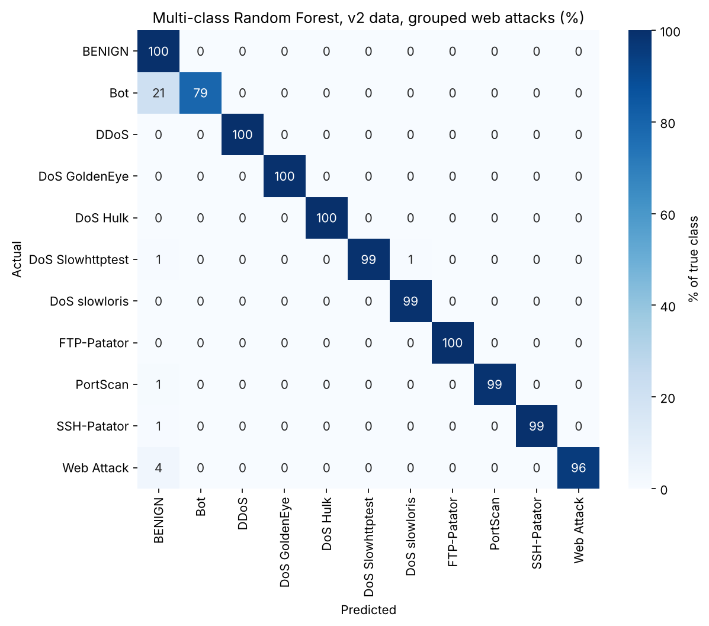

# XNIDS: Explainable Network Intrusion Detection (work in progress)

An independent-study project for my Cybersecurity major. The goal is a machine-learning network intrusion
detector that can **explain why it raised an alert** and **rank alerts by risk**, built on the CICIDS2017 dataset.

This is an early-stage project. The detection models work; the explanation and prioritisation parts are first versions.

## Status

| Part | Status |
|---|---|
| Load and clean the CICIDS2017 data | Done |
| Baseline models (benign vs. DDoS, and 12-class attack detection) | Done |
| Early experiments: grouping web attacks, class imbalance, model comparison, cross-day check | Done |
| Alert priority score and SHAP explanations | First version, not yet validated |
| Dashboard, pcap input, adversarial testing | Not started |

## Results so far

All results come from one full run on the whole dataset (2.83 million flows). Random Forest, 100 trees, seed 42.
Macro-F1 averages the score of every class equally, so it shows weak classes that overall accuracy hides.

| Experiment | Test flows | Macro-F1 |
|---|---:|---:|
| Benign vs. DDoS | 151,039 | 0.9999 |
| 12-class, raw data | 565,562 | 0.911 |
| 12-class, duplicates removed and web attacks grouped | 499,566 | 0.979 |



Observations:

- **Duplicates.** About 11.7% of flows are exact duplicates, mostly in a few attack types (for example 45% of
  SSH-Patator). A duplicate that lands in both the training and test set inflates the score, so they are removed
  before splitting.
- **Web attacks.** Brute Force and XSS were mostly confused with each other, not with normal traffic, because flow
  features describe traffic shape and not web request content. Grouping them into one class fixed this.
- **Different days.** A DDoS model trained on only Tuesday's normal traffic flagged about 10.6% of Monday's normal
  traffic as attacks. Scores within a single day are too optimistic. This was one test with one random seed.
- **Weakest class.** Bot: about 21% of Bot flows are predicted as normal traffic.

## Repository

```
xnids.py       the full pipeline as a script
xnids.ipynb    the same code as a notebook (generated from xnids.py), with saved outputs
reports/            result tables and figures from the full run
tools/              helper scripts (keeps the notebook and script in sync; makes fake test data)
```

## How to run

1. Download the CICIDS2017 CSV files ("MachineLearningCSV.zip") from the
   [dataset page](https://www.unb.ca/cic/datasets/ids-2017.html) and put the eight CSV files in a folder named `data/`.
2. Install: `pip install -r requirements.txt`
3. Run `python xnids.py`, or open `xnids.ipynb` and Run All.

A full run takes about 30 minutes and used up to about 5 GB of RAM on my test machine. For a faster test, set the
environment variable `XNIDS_FAST=1` (PowerShell: `$env:XNIDS_FAST="1"`); results then go to `reports/quick/`.

## Limitations and next steps

- The data is one simulated network over one week, so results may not carry over to real networks.
- Infiltration (36 flows) and Heartbleed (11 flows) are too rare to model and are left out.
- The priority score uses judgement-based severity values and the destination port as a stand-in for how important
  a system is, because this version of the data has no IP addresses.
- Next: validate the SHAP explanations and the priority score, build a dashboard, accept pcap files, and test
  evasion attacks against the model.

## Credits

- Dataset: Iman Sharafaldin, Arash Habibi Lashkari, and Ali A. Ghorbani, "Toward Generating a New Intrusion Detection
  Dataset and Intrusion Traffic Characterization", ICISSP 2018 (Canadian Institute for Cybersecurity, University of
  New Brunswick).

